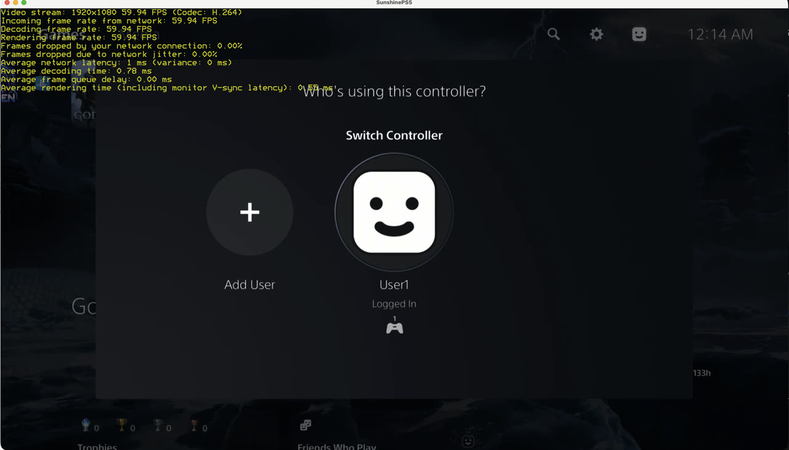
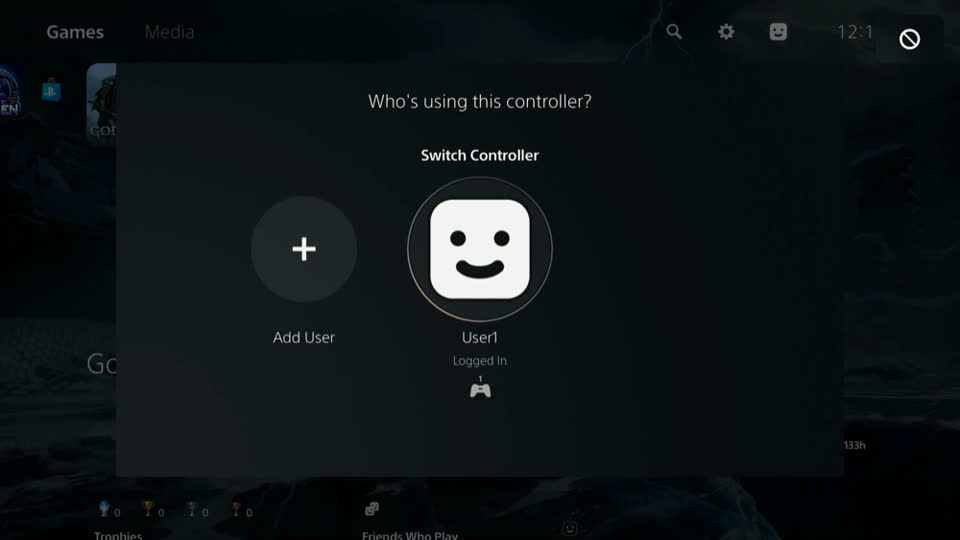

# v0.1.0 MVP validation — 2026-11-02

**Scope (owner decision):** SDR 1920×1080 H.264 at 60 fps, one controller, one game, official
Moonlight for macOS. HDR, multiple controllers and the multi-game matrix are out of scope. Within
that scope the release build passed every check below on real hardware. The broader
speckit acceptance gates in [readiness.md](../../specs/001-moonlight-streaming-host/readiness.md)
(SC-001…SC-014, T045) are **not** claimed by this release.

## Build under test

| Item | Value |
|---|---|
| Artifact | `dist/sunshineps5-stream.elf`, version `sunshineps5-0.1.0` |
| SHA-256 | `acf5e48a9e1692c477f3f7053d3836b927ded4f00cec84135aae51041e0f5f6f` |
| Toolchain | PS5 payload SDK `a7685ce8`, LLVM 18.1.8, OpenSSL 3.5.9, ENet, libopus 1.5.2; `-Werror` clean |
| Console | PS5 firmware 13.60, wired direct link, host auto-bound to `192.168.2.2` with no arguments |
| Client | Official Moonlight 6.1.0 for macOS (Apple M4 Pro, VideoToolbox decode) |

## Official Moonlight 6.1.0 results

Settings: 1920×1080, 60 fps, 20 Mbit/s, H.264, HDR off, stereo, windowed. Statistics are
Moonlight's own end-of-session "Global video stats".

| Session | Duration | Incoming / decode / render fps | Host processing | Network drops | Jitter drops | Host result |
|---|---:|---|---:|---:|---:|---|
| Release build | 2:57 | 59.98 / 59.98 / 59.97 | 0.1 ms | 0.00% | 0.02% | `ended clean=true`, 10,479 frames |
| Reconnect (same host) | 0:40 | 60.10 / 60.10 / 60.02 | — | — | — | `ended clean=true`, 2,317 frames |
| Pre-fix baseline (diagnostic pacing) | 2:26 | 59.61 / 59.61 / 59.60 | 0.1 ms | 0.00% | 0.02% | `ended clean=true`, 8,552 frames |

No decoder errors were logged. Average network latency was 1 ms, and decode time was 1.4 to
2.3 ms. Host thread CPU was 0.06–0.7 s per 10 s window while streaming, and peak RSS was
~90 MiB with no growth.

## Controller input

The Mac had no gamepad attached, so controller input was driven by the project's protocol test
client (`tools/moonlight-mcp`) over the same pairing and control channel:

- `CON-input` **Pass**: the host received every declared action (connect, button press and
  release, neutral stick) and submitted each to the virtual pad without error.
- Console effect: a PS-button press from the virtual pad produced the console's on-screen
  "not allowed" indicator, because a modal controller-assignment dialog for another pad was
  open (below). Earlier diagnostic runs showed Options opening the game's pause menu and
  Cross confirming a game dialog (see the T079 diagnostic report).
- Six consecutive sessions on one takeover host kept the shared virtual pad alive (previously
  the fifth teardown deleted it).

## Host takeover

Sending a new build to a running host hands the virtual controller over without a new pad:
three consecutive takeovers logged `{"event":"takeover","reused_handle":983819}`, including
one from a host that had never run a controller session (the case that previously created a
second pad). The number of resident processes did not grow.

## Automated checks

- `scripts/check-quality.sh`: all 16 checks pass (LLVM pins, warning-free C build, clang-format,
  clang-tidy, rustfmt, clippy, Biome, Ruff).
- `scripts/check-ps5-adapters.sh`: pass.
- `ctest`: 64/64 unit and probe tests pass.

## Observed limitations

- The console displayed "Who's using this controller?" throughout testing. It belongs to a
  virtual pad created by an earlier development host, which still holds it. Virtual pads and
  their holders persist until the console reboots, and only a pad's owner can answer the
  dialog. A clean console boot with one host avoids this. Streaming is unaffected.
- Keyboard and mouse input from Moonlight are not forwarded.
- Audio: on the release build the test client decoded 1,198/1,198 Opus packets with zero
  missing or failed packets, and both channels were non-silent (~99.8% non-zero samples).
  Audible playback through the official client's speakers was not independently checked.
