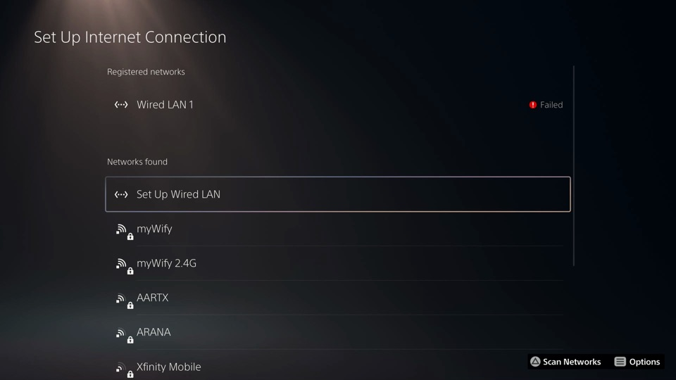
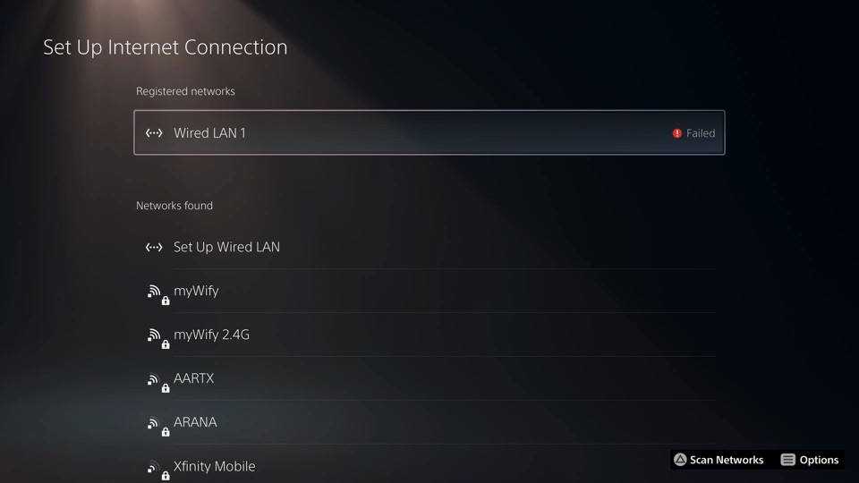

# v0.1.2 validation — 2026-11-03

Same scope as [v0.1.0](v0.1.0-validation.md). This record covers the three console fixes in
v0.1.2 and repeats the official-client stream and controller checks on the release package. It
is also the first run on a home router network instead of a direct cable.

## Build under test

| Item | Value |
|---|---|
| Artifact | `sunshineps5-0.1.2.tar.gz`, `sunshineps5.elf` version `sunshineps5-0.1.2` |
| SHA-256 | ELF `3ae1fb70c74d4a80e7881b3f422af1c08f95e04e665f64de537ffd5b710c3e05`; published archive `5f12dd755d85834de7915e59aa7eb6a0f4c370b04a085698e7db102c30913bbf`. The console runs used archive `a5d3e1d0…`, with the same ELF and an earlier wording of `RELEASE-NOTES.md` |
| Console | PS5 firmware 13.60, wired to a home router, static `192.168.1.20` / `192.168.1.21`, DNS blackholed (the console's own internet test reports *Failed*) |
| Client | Official Moonlight 6.1.0 for macOS on the same LAN; `tools/moonlight-mcp` for controller input |

The diagnostic build used to measure the encoder behaviour below has the same SHA-256 as the
release ELF. The address-change rows used `382f4415…`, which is the release source without the
key-frame change. Its address and logging code is identical to the release.

## Router network, published v0.1.1

The published v0.1.1 package was sent to the console after it moved from the direct link to
`192.168.1.20`. The host picked the new address on its own and took over the running host's
controller (`descriptor_received=true reused_handle=721677`). Official Moonlight reached the
existing pairing at the new address without pairing again. A ~70 s stream: 60.11 / 60.11 / 60.01
fps, 0.00% network drops, 1 ms latency, `ended clean=true`.

## Fix 1: closing the send terminal

The host's stdout is the loader connection opened by `send-to-ps5.sh`.

| Build | Send terminal closed (Ctrl+C), then a new stream |
|---|---|
| v0.1.1 (published) | Moonlight: *RTSP ANNOUNCE request failed* (the `reserved` log write failed and the session was refused) |
| v0.1.2 | ~35 s stream, 60.15 / 60.15 / 59.96 fps, 0.00% network drops |

## Fix 2: console address change

The host was running on `192.168.1.20` with no payload resent while the owner changed the
console's static address in Settings.

| Step | Result |
|---|---|
| `.20` → `.21` | `address_changed from=192.168.1.20 to=192.168.1.21`; no `accept_error`; `serverinfo` `LocalIP` `192.168.1.21`; web page served at `http://192.168.1.21:8081`, and a request naming the old authority is refused (403) |
| Stream on `.21` | 60.29 / 60.29 / 60.13 fps, 0.00% network drops |
| Controller on `.21` | same pad `721677`, CON-input **Pass**, D-pad Down/Up moved the focus |
| `.21` → `.20` (release-candidate package) | `LocalIP` `192.168.1.20`, web page on `.20`, nothing listening on `.21` |

The log line for the second change did not arrive, because the log connection ran over the
address that had just been removed. Later sessions on that host were unaffected (fix 1).

## Fix 3: frozen picture after a lost frame

The first stream after the `.21` → `.20` change showed no picture for its whole 63 s. Moonlight's
decode queue overflowed while it recreated its renderer for a window event. It then asked for an
IDR 32 times and logged *Waiting for IDR frame* 3,614 times. The diagnostic build showed:

- Avcap2 emits an IDR only when its stream starts: 22 consecutive one-second windows had
  `key_frames=0`;
- Moonlight sends `0x0302` (request IDR) twice at every session start and whenever it loses a
  frame; v0.1.1 ignored it;
- restarting the Avcap2 video stream takes 54–83 ms, and the next record is an IDR every time
  (`keyframe_first key_frame=true`).

To cause real frame loss, the Moonlight process was paused with `SIGSTOP` for 2 s mid-stream,
which overflows its receive buffers:

| Build | After the 2 s stall |
|---|---|
| v0.1.2 release candidate (`382f4415…`, no key-frame fix) | *Waiting for IDR frame* from 0:14 to the end of the session at 0:30 (1,085 lines): picture frozen until disconnect |
| v0.1.2 release | IDR waits only in the second of the stall; picture back within a second. ~95 s session: 58.58 / 58.58 / 58.54 fps, 2.31% network drops (the stall), `ended clean=true` |

## Release package checks

All on `192.168.1.20`, package deployed with its own `send-to-ps5.sh`:

- takeover: `descriptor_received=true reused_handle=721677`, old host exited;
- official Moonlight with the stall above: three `keyframe_restart ok=true`, each followed by an
  IDR;
- controller: CON-input **Pass**, no `input_error`, D-pad Down then Up;
- send terminal closed, then a new ~35 s stream: no IDR waits, 60.15 / 60.15 / 59.96 fps.

| D-pad Down | D-pad Up |
|---|---|
|  |  |

Host tests: 64/64 under UBSan on macOS; `scripts/check-quality.sh` and
`scripts/check-ps5-adapters.sh` pass.
