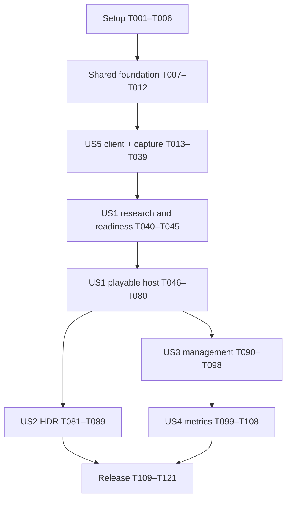

# Tasks: Self-Contained Moonlight Streaming Host

**Input**: [spec.md](./spec.md), [plan.md](./plan.md), [research.md](./research.md), [data-model.md](./data-model.md), [contracts](./contracts/measurement-evidence.md), and [quickstart.md](./quickstart.md).
**Generated**: 2026-10-24 | **Branch**: `001-moonlight-streaming-host`
**Status**: Regenerated at the owner's request. **Hardware readiness remains ERROR until T045 passes.**
**Scope**: All five user stories. Licensing work is excluded per the owner's instruction; no license or constitution changes are implied.
**Tests**: Included because the feature requires automated verification/CI (FR-054–FR-059) and the constitution requires unit tests for new core behavior, regression tests, E2E, sanitizers and parser fuzzing.
**Organization**: Setup → shared foundation → US5 → US1 → US2/US3 → US4 → release. Priority ties follow the accepted test-client-first decision.

The earlier plan's instruction to regenerate tasks after research described its previous pass.
This explicit task-generation request produces a conditional executable backlog now; it does not
declare that the open capability, calibration or budget gates passed. Preparatory reference-client
work remains independent of console capture. T040–T045 turn the unresolved evidence into concrete
research tasks, and every later production-host task depends on that decision.

## Format and execution rules

- Every task uses `- [ ] T### [P?] [US#?] description`, exact repository-relative output paths and explicit predecessor IDs.
- `[P]` permits concurrency only with peers in the listed batch after every predecessor finishes; it never bypasses a prerequisite or permits simultaneous writes to the same file.
- Setup, foundation and release tasks have no story label; all story tasks have their matching label.
- Follow task IDs as a safe serial order. The dependency graph permits independent branches where stated.
- Quoted model constraints are copied verbatim from [data-model.md](./data-model.md); types, enums, missing-value rules and limits are part of the task.
- Contract/unit tests precede the corresponding behavior and must expose the absent/incorrect behavior before it is implemented. A bug fix includes a failing regression case.
- Every core behavior includes unit coverage; every platform/hot-path change records firmware, client/version, mode/codec, before/after timings and resource evidence. More than 5% p99 regression needs the constitution's documented review exception.
- Use fixed pools, bounded queues and designated wait/send points; input cannot wait for capture, encode, send, exports or statistics work. Never promote a guessed console interface or missing observation into a shipping capability.
- Hardware tasks require verified IPv4/IPv6 internet isolation and exclusive console/capture-device ownership. Preserve the existing homebrew setup and apply sourced, reversible operations only.
- An unresolved mandatory probe/calibration result leaves dependent tasks pending. Incomplete acceptance reports preserve known failures and never count as a passing checkpoint.
- These task checkboxes track future work. Custom checklist markers remain reviewer-owned and unchanged.

## Path conventions and source ownership

Host: `core/` and `platform/`; static app: `webapp/`; independent Rust client:
`tools/moonlight-mcp/`; isolated USB helper: `tools/hdr-capture/`; nonshipping console probes:
`tools/ps5-probes/`; tests: `tests/`; CI: `.github/workflows/`.
Task paths are intended files; absent future files are not claims of implemented capabilities.
The worker assigned a task owns its listed files for that task and must preserve others' edits.

| Design surface | Story allocation |
|---|---|
| [Moonlight contract](./contracts/moonlight-protocol.md) | US1 protocol, pairing, SDR/input and cleanup; US2 HDR |
| [Web contract](./contracts/web-app-api.md) | US1 pairing/status and early evidence routes; US3 management; US4 metrics/diagnostics |
| [Client contract](./contracts/test-client-cli.md) | US5 scenarios, recording, reports, CLI and agent tools |
| [Measurement contract](./contracts/measurement-evidence.md) | US5 evidence authority; US1 timing engine; US2 HDR evidence; US4 overhead/coverage; release gates |
| Host / Paired Device / Pairing Request / Session / Settings | US1 first definitions; US3 management and US4 user controls |
| Metrics Capture / Session Aggregates | US1 early collection/aggregation; US4 presentation/export |
| Measurement Evidence / Test Report / Reference Recording | US5 first definitions; later story evidence consumers |

## Phase 1: Setup (Shared Infrastructure)

**Goal**: Pin toolchains, establish reproducible build/test machinery and record acceptance scope.

**Prerequisites**: No prior task dependency; all tasks remain unchecked. Configuration scaffolding is not a successful host build.

- [X] T001 Record the executable scope and resolve operational ambiguities (invalid/absent bitrate versus valid out-of-range bitrate, protected audio, measurement-error policy, immediate input release, and FR-057's reference-recording wording) in `specs/001-moonlight-streaming-host/contracts/implementation-decisions.md`; preserve accepted answers, distinguish unresolved evidence from owner choices, and propagate settled requirements into the related contracts before their implementation. (FR-018, FR-022, FR-034, FR-047, FR-057) [Depends: none]

- [X] T002 Create the C11 portable build and test targets in `CMakeLists.txt` and `tests/CMakeLists.txt`, and pin SDK v0.45 source a7685ce8e97ce1f8a4f38253a41d54241c9124f1, LLVM 18.1.8, OpenSSL 3.5.9 source 45e844fa2a14ec92d146bd8f5778ac130b6625fb, and verified archive checksums in `cmake/dependencies.lock.json`; resolve local-tool archive provenance, treat warnings as errors, and keep console imports out of core targets. Pin the build-system version in the manifest as well. [Depends: T001]

- [X] T003 [P] Configure C formatting/static analysis in `.clang-format` and `.clang-tidy`, Rust formatting in `tools/moonlight-mcp/rustfmt.toml`, and one local quality entry point in `scripts/check-quality.sh` for clang-format, clang-tidy, rustfmt, and Clippy; no warning suppression to manufacture a clean build. Pin Playwright browser tests and Python schema-test tooling in `package.json` and `tests/requirements.lock`; configure their appropriate format/lint checks in the same quality entry point. [Depends: T002]

- [X] T004 [P] Pin Rust 1.93.0 in `tools/moonlight-mcp/rust-toolchain.toml`, reconcile `tools/moonlight-mcp/Cargo.toml` and `tools/moonlight-mcp/Cargo.lock` without relaxing `unsafe_code = "forbid"`, and record FFmpeg/ffprobe 8.0.1, libopus 1.5.2, and libusb 1.0.29 prerequisites in `tools/moonlight-mcp/docs/build.md`. [Depends: T002]

- [X] T005 [P] Define local-only evidence destinations, secret exclusions, bounded artifact retention, and source/build provenance in `docs/evidence-layout.md` and `.gitignore`; retain run manifests/checksums and first/last soak summaries while excluding credentials, raw captures, device serials, and generated binaries from version control. (FR-050, FR-053, FR-060) [Depends: T002]

- [X] T006 Create versioned acceptance profiles in `tests/scenarios/profiles/acceptance.json` covering SC-001 through SC-014, strict thresholds, fixed required sets, Incomplete precedence, and first-release-only regression exclusion; label calibration-dependent SDR/HDR targets unresolved rather than inventing them, and distinguish reference-host compatibility from PS5 release acceptance. (SC-001, SC-002, SC-003, SC-004, SC-005, SC-006, SC-007, SC-008, SC-009, SC-010, SC-011, SC-012, SC-013, SC-014) [Depends: T003, T004, T005]

**Checkpoint**: Setup definitions and profiles exist with unresolved calibration targets explicitly identified.

## Phase 2: Foundational (Blocking Shared Prerequisites)

**Goal**: Provide portable interfaces, bounded runtime support, real fakes and mandatory portable CI.

**Prerequisites**: Phase 1 complete. T007–T012 must finish before any user-story implementation.

- [X] T007 Define narrow capture, encode, audio, input, system, and clock interfaces in `core/platform.h` and `core/evidence.h`, including buffer ownership, stage boundaries, capture protection, HDR source epochs, input-delivery meaning, rollback, and clock validity; these are portable contracts, not assertions that an SDK stub is callable. [Depends: T006]

- [X] T008 Implement checked bounded buffers, monotonic-time conversion, reason-coded errors, and bounded/redacted logging in `core/runtime.c` and `core/runtime.h`, with failure/overflow/clock unit tests in `tests/unit/test_runtime.c`; integer-microsecond durations round down with explicit quantization uncertainty, and no steady-state producer allocation is allowed. [Depends: T007]

- [X] T009 Implement deterministic platform fakes in `tests/fakes/platform.c` and `tests/fakes/platform.h` after the interfaces exist: synthetic SDR/HDR frames/audio, separate input delivery, controllable clocks, resource failures, protection, conflicts, and teardown counters; add ownership/lifecycle tests in `tests/unit/test_fakes.c`. [Depends: T008]

- [X] T010 Create `.github/workflows/portable.yml` to build warning-free core and locked test client on Linux/macOS, run actual unit tests and language quality checks, and run host tests with AddressSanitizer/UndefinedBehaviorSanitizer; missing test targets or empty test discovery must fail. [Depends: T009]

- [X] T011 [P] Create `scripts/audit-dependencies.sh` and `.github/workflows/dependencies.yml` to audit pinned dependency versions, integrity, and known vulnerabilities for host and client; record the owner's licensing exclusion explicitly without imposing a license gate or representing a deferred audit as passed. [Depends: T010]

- [X] T012 [P] Define versioned scenario, evidence, and host-observation schemas in `tests/schemas/scenario.schema.json`, `tests/schemas/evidence.schema.json`, and `tests/schemas/host-observation.schema.json`; include session/frame/event IDs, source clock and coverage, explicit absence, and controller-only scope, plus schema validation in `tests/unit/test_schemas.py`. (FR-054, FR-056, FR-058) [Depends: T010]

**Checkpoint**: Portable runtime/fakes and schema tests pass on Linux/macOS; no console capability is inferred.

## Phase 3: User Story 5 — Verify a build automatically (Priority: P1; delivered first)

**Goal**: Deliver an independent protocol client, native SDR/HDR recording, comparison, reporting and agent tools.

**Prerequisites**: Phase 2 complete. This work has no dependency on a working SunshinePS5 host or R3 console capture APIs.

**Independent Test**: Against an independent reference host, complete official-compatible pairing, a scripted stream and controller response, simultaneous native-format recording/comparison, and valid report/status behavior; record the reference-host criterion set before the run. Actual HDR acquisition/calibration is part of this story.

### Contract and validation tests

- [X] T013 [P] [US5] Add source-pinned pairing-proof, HTTP/RTSP/control/input framing, sequencing, and malformed-message fixtures in `tools/moonlight-mcp/tests/protocol_contract.rs`; require official-client rejection behavior and isolate test identities. (FR-054, FR-055) [Depends: T011, T012]

- [X] T014 [P] [US5] Add report/status tests in `tools/moonlight-mcp/tests/evidence_contract.rs` for every required report field, immutable criterion sets, incomplete-plus-failed results, missing numeric values, bitrate clamp reporting, exit outcomes, and invalid invocation. (FR-056, FR-058) [Depends: T011, T012]

- [X] T015 [P] [US5] Add native-resolution SDR/ten-bit HDR and clock/alignment fixtures in `tools/moonlight-mcp/tests/capture_contract.rs` covering known shifts, altered/identical pictures, missing timestamps/frames, and a still scene with indeterminate delay; no real hardware claim may derive from these fixtures. (FR-057, FR-061) [Depends: T011, T012]

### Models and implementation

- [X] T016 [P] [US5] Implement typed measurement/input evidence in `tools/moonlight-mcp/src/evidence.rs`, correlating client-sent, host-received, and console-delivered events without equating an ACK to delivery. Model constraints: `id`, `session_id` (type “identifiers”): “Stable references from criterion results.”; `kind`, `source` (type “enums”): “Host pipeline, protocol header, client receipt, reference recording, or operator observation.”; `interval`, `clock_domain` (type “timestamps and clock ID”): “Define where the measurement starts/ends; unrelated clock values are never directly subtracted.”; `units`, `resolution`, `uncertainty` (type “metadata”): “Explicit quantization and verified accuracy where available.”; `population`, `coverage` (type “counts and validity”): “Identify expected versus observed data and all exclusions.”; `value`, `lower_bound`, `upper_bound` (type “nullable values”): “Missing numeric evidence is absent, never zero. Bounds do not masquerade as exact values.”; `validity`, `reason`, `artifact_refs` (type “state and references”): “Reproducible evidence and an explanation of any deficiency.” (FR-056, SC-005) [Depends: T013, T014, T015]

- [X] T017 [P] [US5] Implement versioned report records and streaming artifact references in `tools/moonlight-mcp/src/report.rs`; emit a report for every valid declared run, including interruption and missing evidence. Model constraints: `schema_version`, `run_id`, `session_id` (type “identifiers”): “Keep format version and correlation explicit.”; `scenario` (type “immutable declared input”): “Requested mode, duration, controller sequence, and required criterion IDs are fixed before the run.”; `environment` (type “record”): “Firmware, host/client versions, network, devices, reference chain, clocks, and calibration IDs.”; `requested`, `chosen`, `bitrate_adjustment` (type “records”): “Preserve both requested and actual chosen targets; measured bitrate is separate.”; `video`, `audio`, `input`, `hdr_events`, `fidelity` (type “evidence references”): “Include all FR-056/FR-057 fields and their validity.”; `criteria` (type “result list”): “Each required criterion has ID, threshold, evidence IDs, Pass/Fail/Incomplete, and reason.”; `overall_status` (type “enum”): “Pass, Fail, or Incomplete according to the precedence below.”; `limitations`, `artifact_refs` (type “bounded metadata”): “Point to local streamed evidence files; do not accumulate all frame data in report memory.” (FR-056) [Depends: T013, T014, T015]

- [X] T018 [P] [US5] Implement recording metadata and validity in `tools/moonlight-mcp/src/recording.rs`, preserving native geometry/precision and recording required-source evidence separately from received HDR signaling. Model constraints: `source`, `capture_mode`, `calibration_id` (type “metadata”): “Identify device, geometry, frame rate, and calibration; device presence alone is not calibration evidence.”; `frames` (type “local file sequence”): “Preserve the resolution and signal format needed by the criterion.”; `timestamps` (type “one per frame”): “Use the same test-machine monotonic domain as stream receipt, including across capture-service processes.”; `pixel_format`, `bit_depth`, `color_space` (type “explicit format”): “SDR and 10-bit HDR PQ/BT.2020 remain distinct.”; `frame_count`, `timestamp_count`, `validity` (type “counts and state”): “A disagreement invalidates the recording.”; `metadata_evidence` (type “separate evidence reference”): “Source HDR metadata cannot be inferred merely from USB pixel capture.” (FR-057, FR-061) [Depends: T013, T014, T015]

- [X] T019 [US5] Implement scenario parsing in `tools/moonlight-mcp/src/scenario.rs` against the shared schema: fixed required criteria/profile version, selected mode/bitrate, duration, timed controller actions, explicit noninteractive PIN delivery, evidence sources, and bounded local output paths. (FR-054, FR-058) [Depends: T016, T017, T018]

- [X] T020 [US5] Replace spike-specific shortcuts in `tools/moonlight-mcp/src/pairing.rs` and `tools/moonlight-mcp/src/http.rs` with full official-compatible certificate/signature/challenge validation, pinned host identity, isolated persistent client state, app listing, and explicit manual/automated PIN strategies; no silent interactive wait in unattended scenarios. (FR-054, FR-055, FR-059) [Depends: T019]

- [X] T021 [P] [US5] Implement negotiated RTSP/SDP session establishment and teardown in `tools/moonlight-mcp/src/rtsp.rs` using the pinned protocol notes, preserving requested and host-chosen settings without treating bitrate measurements as negotiated targets. (FR-054, FR-056) [Depends: T020]

- [X] T022 [P] [US5] Implement reliable control transport, required crypto, keepalives, HDR state events, and rumble handling in `tools/moonlight-mcp/src/control.rs` using the locked ENet/crypto dependencies and cited channel semantics. (FR-054, FR-056) [Depends: T020]

- [X] T023 [US5] Implement frame reassembly, missing/incomplete accounting, actual FEC recovery and recoverable-but-not-recovered attribution in `tools/moonlight-mcp/src/video.rs` and `tools/moonlight-mcp/src/fec.rs`; report protocol latency with its compatible units/zero/saturation meaning and keep host drops distinct from client loss. (FR-056) [Depends: T021, T022]

- [X] T024 [P] [US5] Implement bounded decode/output processing in `tools/moonlight-mcp/src/decode.rs` preserving native resolution, SDR versus ten-bit PQ/BT.2020, per-frame timestamps, and signaled HDR changes; explicitly reject silent 960×540/8-bit normalization for acceptance. (FR-056, FR-061) [Depends: T023]

- [X] T025 [P] [US5] Implement audio packet sequence/loss, stereo decode, and non-silence measurement in `tools/moonlight-mcp/src/audio.rs`, with defined observation populations and missing-decode evidence. (FR-056) [Depends: T023]

- [X] T026 [P] [US5] Implement controller-only scenarios in `tools/moonlight-mcp/src/input.rs`: connect/disconnect the single required controller identity (extra identities may be represented but are ignored), required buttons/axes, motion/touch, feedback, and transport outcomes; distinguish these from imported host-delivery evidence and omit keyboard/mouse expansion. (FR-054, FR-056) [Depends: T023]

- [X] T027 [US5] Implement monotonic frame intervals, measured bitrate, host-evidence import, per-input delivery correlation, and percentile validity in `tools/moonlight-mcp/src/measurements.rs` and `tools/moonlight-mcp/src/clock.rs`; protocol, full-pipeline, client-reception, and HDMI-relative timing remain distinct. (FR-056, SC-003, SC-004, SC-005) [Depends: T024, T025, T026]

- [X] T028 [US5] Replace recording transport in `tools/moonlight-mcp/src/capture_server.rs` with bounded loopback-only requests, confined output paths, cancellation/cleanup, local frame timestamps on a shared monotonic clock, and explicit device ownership; retain safe Rust and keep privileged USB operations outside the process. (FR-057, FR-060, FR-061) [Depends: T027]

- [X] T029 [US5] Implement native 1080p60 SDR recording in `tools/moonlight-mcp/src/reference.rs` through the capture service, with one valid monotonic timestamp per frame, source/color metadata, loss accounting, and bounded disk/backpressure handling. (FR-057) [Depends: T028]

- [X] T030 [US5] Build the isolated helper in `tools/hdr-capture/uvc_capture.c` and `tools/hdr-capture/CMakeLists.txt` from the pinned reference approach; select observed 0fd9:009c by descriptors instead of assuming 009b, negotiate advertised 1080p60 P010, validate buffers, and restore device ownership on normal/error exit; document the bounded local frame interface in `tools/hdr-capture/protocol.md`. (FR-061) [Depends: T029]

- [X] T031 [US5] Integrate the external helper into `tools/moonlight-mcp/src/hdr_capture.rs`, preserving ten-bit frames, source precision/color context, timestamps and cleanup; a required unavailable HDR path yields Incomplete rather than an eight-bit substitute. (FR-061) [Depends: T030]

- [X] T032 [US5] Complete R4 device acquisition evidence in `specs/001-moonlight-streaming-host/research-r4-capture.md`: document the connected 5 Gbit/s device, actual P010 1080p60 frames/cadence/loss, known HDR signal, timestamp agreement, disconnect recovery, and restored device ownership; descriptor enumeration alone cannot close this task. (FR-061) [Depends: T031]

- [X] T033 [US5] Implement full-population SSIM/PSNR and temporal alignment in `tools/moonlight-mcp/src/compare.rs` and `tools/moonlight-mcp/src/stats.rs`, stream per-frame results/sample pairs locally, preserve PQ/BT.2020, and expose exclusions/uncertainty without the spike's default 300-frame acceptance cap. (FR-057, FR-061, SC-014) [Depends: T032]

- [X] T034 [US5] Calibrate native SDR/HDR reference error and delay uncertainty in `specs/001-moonlight-streaming-host/research-r4-calibration.md`; document repeatable scenes, temporal evidence as well as still-frame error, and proposed absolute SDR median/HDR fidelity rules; explicitly refine `specs/001-moonlight-streaming-host/spec.md` and `tests/scenarios/profiles/acceptance.json` before using new thresholds, never silently relaxing existing criteria. (SC-013, SC-014) [Depends: T033]

- [X] T035 [US5] Implement criterion evaluation in `tools/moonlight-mcp/src/verdict.rs`: required Incomplete takes overall precedence while individual Fail results persist; otherwise Fail then Pass, absent is never zero, uncertain threshold crossings stay Incomplete, and unavailable evidence cannot remove a criterion. (FR-056) [Depends: T034]

- [X] T036 [US5] Implement `run --scenario FILE --report FILE` in `tools/moonlight-mcp/src/runner.rs` and wire `tools/moonlight-mcp/src/main.rs`; sequence pairing/session/input/simultaneous capture/teardown, always finalize valid-run reports, preserve existing commands, and implement exits 0 Pass, 1 Fail, 2 Incomplete, 64 invalid invocation plus the planned recording/comparison flags. (FR-054, FR-058) [Depends: T035]

- [X] T037 [US5] Implement bounded agent tools in `tools/moonlight-mcp/src/mcp.rs` over the same runner, with typed Pass/Fail/Incomplete, cancellation, local-only outputs, and no treatment of transport success as acceptance. (FR-058, FR-060) [Depends: T036]

- [ ] T038 [US5] Create `tests/scenarios/reference-host.json` and validate pairing, stream, controller application, audio/HDR reporting, fidelity and teardown against the independent Wolf/Direwolf or Sunshine host; retain exact versions, official-client cross-checks, and the complete evidence in `tools/moonlight-mcp/docs/validation.md`. This is the FR-059 gate before judging SunshinePS5. (FR-059) [Depends: T037]

- [ ] T039 [US5] Integrate the complete client unit/contract suites into `.github/workflows/portable.yml`, add failure/Incomplete CLI and agent integration checks in `tools/moonlight-mcp/tests/runner_contract.rs`, and update current versus planned command documentation in `tools/moonlight-mcp/docs/usage.md`; core-host E2E wiring follows in US1 once that host exists. (FR-058) [Depends: T038]

**Checkpoint**: FR-059 proof exists before the client judges SunshinePS5. Its integration against SunshinePS5 is completed by T069/T079 and later story scenarios.

## Phase 4: User Story 1 — Pair a Moonlight device and play (Priority: P1; playable MVP)

**Goal**: Resolve console capability evidence, then deliver phone pairing and safe SDR streaming with controllers and early timing instrumentation.

**Prerequisites**: US5 complete. T040–T045 are nonshipping research and readiness work. Production-host tasks T046–T080 require a passing T045 decision; a failed/unknown probe cannot be checked off as readiness approval.

**Independent Test**: Pair an Apple TV using only console prompts and a phone, play for 30 minutes with video/audio/controllers, quit without held input or game disruption, reconnect after restart, and record startup, latency, drop, input and resource evidence.

### Research prerequisites — no production-host approval implied

- [X] T040 [US1] Document sourced firmware-13.60 capture/encode/audio/HDR-source/input candidates and verified ABI/permission requirements in `tools/ps5-probes/README.md` and `specs/001-moonlight-streaming-host/research-r3-findings.md`; distinguish import symbols from callable interfaces, inspect maintained SDK/reference sources, and do not call guessed signatures or offsets. (FR-003, FR-016, FR-030) [Depends: T039]

- [ ] T041 [US1] Implement nonshipping sourced capture/encode/audio/HDR probes in `tools/ps5-probes/capture_encode.c`; record sustained baseline modes, hardware encoding, ten-bit output, bounded HDR-to-SDR conversion, source HDR metadata, capture-protection behavior and resource cleanup in `specs/001-moonlight-streaming-host/research-r3-findings.md`. An unavailable mandatory path leaves the hardware gate open. (FR-016, FR-017, FR-019, FR-022, FR-024, FR-025, FR-026) [Depends: T040]

- [ ] T042 [US1] Implement nonshipping sourced controller/coexistence probes in `tools/ps5-probes/input_system.c`; establish successful delivery meaning, single-controller release/removal (with a neutral parked controller across sessions), rumble/motion/touch, Remote Play/Share Play conflict detection, rest/stop cleanup, and game-safe scheduling in `specs/001-moonlight-streaming-host/research-r3-findings.md`. (FR-030, FR-031, FR-032, FR-033, FR-034, FR-037, FR-038) [Depends: T041]

- [X] T043 [US1] Cross-build and device-smoke the pinned crypto/TLS candidate and select a source-cited compatible host ENet transport in `tools/ps5-probes/dependencies.c` and `specs/001-moonlight-streaming-host/research-target-dependencies.md`; verify entropy, certificates, sockets, threading and wire behavior, and update `cmake/dependencies.lock.json` with the selected transport/version. [Depends: T042]

- [ ] T044 [US1] Build the nonshipping timing/resource probe in `tools/ps5-probes/budget.c` and record R5 findings in `specs/001-moonlight-streaming-host/research-r5-budgets.md`: measure real capture/encode/packet/send and input boundaries, all attributable allocations, per-ten-second thread CPU totals, foreground-game impact, baseline SDR/HDR latency and supported bitrate bounds. Compare with 256 MiB total (128 media/80 metrics/48 core), one streaming core-equivalent and 5% idle core; unknown domains remain unresolved. (FR-017, FR-018, SC-003, SC-004, SC-005, SC-009, SC-012) [Depends: T043]

- [ ] T045 [US1] Reconcile R3/R4/R5 and dependency evidence in `specs/001-moonlight-streaming-host/plan.md` and `specs/001-moonlight-streaming-host/research.md`, refine affected contracts/spec only explicitly, and record a readiness decision in `specs/001-moonlight-streaming-host/readiness.md`; pass only with required sourced capabilities and on-device budgets. If a mandatory capability is unsupported or unknown, retain ERROR and stop dependent production-host tasks without inventing a fallback. [Depends: T044, T034]

### Core contract and behavior tests — after readiness approval

- [X] T046 [P] [US1] Add portable parser, pairing proof/expiry/cooldown, private-address, authorization-race, single-session, and bitrate-boundary tests in `tests/unit/test_protocol.c` and `tests/unit/test_pairing.c` using documented fixtures; public/global/mapped-address boundaries and stale pending requests are required cases. (FR-006, FR-009, FR-010, FR-012, FR-018, FR-020, FR-040) [Depends: T045]

- [X] T047 [P] [US1] Add identity/settings durability, corrupt/partial-file, session partial-start/teardown, input translation/removal and conflict tests in `tests/unit/test_lifecycle.c` and `tests/unit/test_input.c`; assert no held input, no leaked resources and preserved foreground-game state through fakes. (FR-011, FR-030, FR-034, FR-035, FR-036, FR-037, FR-038) [Depends: T045]

- [X] T048 [P] [US1] Add exact recorded-value percentile, threshold/overflow, rolling-expiry, whole-session retention, toggle gaps, queue loss and no-extra-off-state-timing tests in `tests/unit/test_metrics.c`; frame/input producers must never wait on aggregation or export. (FR-021, FR-047, FR-048, FR-051, FR-052) [Depends: T045]

### Models, protocol and services

- [ ] T049 [US1] Implement host and settings records in `core/settings/host.c` and `core/settings/host.h`, rejecting control characters in names and exposing only modes implemented and validated on the current build; probe-only support must not advertise a working production capability. Model constraints: `display_name` (type “text”): “Default `SunshinePS5`; owner-editable, 1–63 characters (FR-005, FR-044).”; `identity` (type “key pair and certificate”): “Generated on the console at first run, persistent across restarts, never committed.”; `address` (type “observed network address”): “Shown in the startup notification and web app; not a replacement for identity.”; `state` (type “enum”): “`starting`, `running`, `stopping`.”; `version`, `firmware_version` (type “text”): “Detected values; firmware other than 13.60 is refused (FR-003).”; `supported_modes` (type “bounded capability list”): “Each mode names geometry, frame rate, codec, dynamic range, and declared minimum/maximum bitrate. Only validated modes are offered.”; `host_name` (type “text”): “Follows Host.`display_name`.”; `metrics_enabled` (type “boolean”): “Default false; persisted after a toggle (FR-046).” (FR-003, FR-005, FR-044, FR-046) [Depends: T046, T047, T048]

- [ ] T050 [US1] Implement on-device identity generation and atomic durable settings replacement in `core/settings/store.c` and `platform/system/storage.c`; protect keys, surface persistence failures, fall back to default settings with diagnostics, and never silently replace a damaged identity as though pairing still existed. (FR-011, FR-039, FR-046) [Depends: T049]

- [X] T051 [US1] Implement the paired-device registry in `core/settings/devices.c` and `core/settings/devices.h`, with atomic updates, fail-closed unreadable storage, and an explanation that re-pairing is needed. Model constraints: `id`, `certificate` (type “certificate identity”): “Identity comes from the paired certificate, not a client-supplied name or identifier.”; `name` (type “text”): “Owner-editable, 1–63 characters; client-supplied text is untrusted.”; `paired_at` (type “timestamp”): “Established once on successful pairing.”; `last_session_at` (type “timestamp or absent”): “Updated after a session ends.” (FR-011, FR-012, FR-043) [Depends: T050]

- [X] T052 [P] [US1] Implement the shared transport-peer classifier in `core/protocol/address.c`: permit RFC1918 IPv4 and routed fc00::/7, permit on-link fe80::/10, normalize mapped IPv4, reject every other source class and ignore claimed forwarded addresses; no subnet-equality rule or automatic external exposure. (FR-040, FR-041) [Depends: T051]

- [X] T053 [P] [US1] Implement session admission and state records in `core/session/session.c` and `core/session/session.h`, admitting one paired device and assigning every end a reason. Model constraints: `id` (type “session identifier”): “Correlates host, client, metrics, and evidence records.”; `device` (type “Paired Device reference”): “Must remain authorized.”; `state` (type “enum”): “`negotiating`, `active`, `ending`, `ended`.”; `started_at` (type “timestamp”): “Monotonic duration and wall-clock display context are separate.”; `width`, `height`, `fps`, `codec` (type “negotiated values”): “Must identify a validated offered mode.”; `dynamic_range` (type “enum”): “`sdr` or `hdr`; changes are timestamped and signaled without reconnecting.”; `requested_bitrate_kbps` (type “integer”): “Preserved exactly from the client request.”; `chosen_bitrate_kbps` (type “integer”): “Request within bounds; otherwise the nearest supported minimum or maximum (FR-018).”; `bitrate_adjustment` (type “enum”): “`none`, `raised_to_minimum`, or `lowered_to_maximum`.”; `measured_bitrate_bps` (type “measurement or absent”): “Observed bytes over a stated interval; never substituted for the chosen encoding target.”; `controllers` (type “bounded list”): “Up to four; IDs, connection order, state, and delivery-result counters.”; `end_reason` (type “reason or absent”): “Assigned exactly once; retained in diagnostics.” (FR-018, FR-020, FR-039) [Depends: T051]

- [X] T054 [US1] Implement pending pairing state in `core/protocol/pairing_state.c` and `core/protocol/pairing_state.h`; permit one pending request, preserve failure count across requests, apply five-failure/60-second cooldown, reset on success, and reject stale request IDs. Model constraints: `id` (type “unique request identifier”): “Changes for every request; PIN submission must match the current pending request, so stale submissions are rejected.”; `started_at`, `expires_at` (type “monotonic deadline plus display time”): “Expiration is five minutes after the request starts.”; `state` (type “enum”): “`pending` → `completed`, `failed`, or `expired`; terminal states are final.”; `client_name` (type “text”): “Untrusted display metadata.” (FR-009, FR-010) [Depends: T052, T053]

- [X] T055 [US1] Implement bounded HTTP/HTTPS parsing and Moonlight server-info, pairing, app-list, launch/resume/cancel routing in `core/protocol/http.c` and `core/protocol/http_parser.c`, using maintained crypto/TLS, authorized identities and source-cited constants; list exactly one PS5 app and decline a second session without disturbing the first. (FR-006, FR-012, FR-020, FR-023) [Depends: T054]

- [ ] T056 [US1] Implement the complete PIN/certificate/challenge proof flow in `core/protocol/pairing.c`, persist successful identities, and produce request/completion notifications within the pairing contract; prove official-client compatibility rather than tolerating the spike's previous shortcuts. (FR-006, FR-007, FR-008, FR-011) [Depends: T055]

- [X] T057 [P] [US1] Implement local-link discovery and manual-address support in `core/protocol/discovery.c`; advertise default/renamed host identity, preserve routed-private manual entry, and avoid relay or router configuration. (FR-004, FR-005) [Depends: T056]

- [X] T058 [P] [US1] Implement bounded RTSP/SDP negotiation in `core/protocol/rtsp.c` and `core/protocol/negotiation.c`, validated mode selection and nearest-boundary bitrate clamping with requested/chosen reporting; reject unsupported geometry/codec without accepting a broken session. (FR-017, FR-018) [Depends: T056]

- [X] T059 [P] [US1] Implement selected reliable control transport, source-cited encryption/channel semantics, keepalives and client loss/recovery feedback in `core/protocol/control.c`; authenticate every stream/input/control request and propagate end reasons. (FR-012, FR-034, FR-035, FR-047) [Depends: T056]

- [X] T060 [US1] Implement bounded video packetization, FEC and encryption in `core/protocol/video.c` and `core/protocol/fec.c` with source-pinned vectors in `tests/unit/test_media_protocol.c`; preserve protocol latency semantics separately from final-send completion and prohibit hot-path heap allocation. (FR-016, FR-021) [Depends: T057, T058, T059]

- [X] T061 [US1] Implement stereo audio packetization/encryption in `core/protocol/audio.c` with sequence/loss/reference vectors in `tests/unit/test_audio_protocol.c` and fixed buffers. (FR-019) [Depends: T060]

- [X] T062 [US1] Implement controller parsing/translation in `core/input/controller.c`, including proportional triggers, guide/PS, touchpad click, motion/touch data, four ordered identities, extra-controller refusal, disconnect/reconnect and independent delivery; forward supported rumble through the control channel. (FR-030, FR-031, FR-032, FR-033, FR-034) [Depends: T061]

### Timing foundations — before production streaming

- [X] T063 [US1] Implement fixed frame/input record layouts and separate producer queues in `core/metrics/records.c` and `core/metrics/records.h`: 64-byte frame records, 32-byte input records, preallocated 8 MiB/64 MiB rings, no additional off-state timestamps beyond FR-021, and receipt timestamps preceding parse/auth for correlated accepted inputs. Model constraints: `session_id` (type “identifier”): “Links every record to one session; no cross-session aggregation.”; `clock` (type “clock description”): “Clock domain, observed native resolution, conversion rule, and measurement uncertainty.”; `frame_samples` (type “fixed raw ring”): “Frame ID/time and capture, encode, packetize, send, full-pipeline durations; outcome/validity flags.”; `input_samples` (type “fixed raw ring”): “Event ID, controller, time, receipt-to-console-delivery duration, delivery result, validity flags.” (FR-021, FR-047, FR-052) [Depends: T062]

- [X] T064 [US1] Implement checked counters, enabled intervals and retention validity in `core/metrics/coverage.c`; keep all metadata within the fixed pool, aggregate before raw eviction, expire at 600 seconds or earlier capacity, and flag affected evidence when samples/coverage are lost. Model constraints: `enabled_intervals` (type “bounded coverage description”): “Records enabled/disabled transitions and coverage gaps; overflow of this description invalidates coverage rather than growing memory.”; `retained_interval` (type “actual first/last retained times”): “Report separately for frame and input records; never promise ten minutes when capacity retained less.”; `population` (type “counts per channel/window”): “Seen, represented in bins, overflow, missing/lost, and failed-delivery counts.”; `validity` (type “state and reasons”): “Includes queue gaps, counter overflow, invalid clocks, unavailable stages, and insufficient coverage.”; `continuous` (type “bounded counters”): “Host frame outcomes, measured bitrate, and separately identified client loss/recovery reports.”; `context` (type “record”): “Versions, mode, dynamic range, requested/chosen bitrate, and client name for export.” (FR-047, FR-051, FR-052) [Depends: T063]

- [X] T065 [US1] Implement the six-channel whole-session and exact rolling-ten-second summaries in `core/metrics/aggregate.c`: two sets of 65,536 uint64 bins (6 MiB total), nearest rank over counts including overflow, exact in-range recorded values and absent overflow quantiles with lower bounds; preserve enabled-period history across raw eviction. Model constraints: `whole_session` (type “six fixed histograms”): “Counts all valid detailed samples from enabled periods, including samples whose raw records expired.”; `last_10_seconds` (type “six fixed histograms”): “Exact rolling window over recorded timestamps; expiry removes the original observation from its bin.” (FR-048, FR-049) [Depends: T064]

- [X] T066 [US1] Integrate the nonblocking statistics worker and bounded snapshots in `core/metrics/engine.c`; enforce the complete 80 MiB metrics ceiling, preserve FR-021 latency when detailed metrics are off, expose enabled gaps, and make evidence readable before any production hot-path changes through `core/metrics/evidence_export.c` using the shared observation schema. (FR-046, FR-047, FR-048, FR-050, FR-052) [Depends: T065]

- [X] T067 [US1] Implement pool reservation, independent input scheduling, partial-start unwind and input-first teardown in `core/session/lifecycle.c`; attach the metrics engine before streaming, enforce measured budget/mode limits, and end lost sessions within ten seconds while recording distinct reasons. (FR-020, FR-034, FR-035, FR-036, FR-039) [Depends: T066]

- [X] T068 [US1] Compose a runnable portable host using fakes in `tests/fakes/host_main.c` and wire its build in `tests/CMakeLists.txt`; require real protocol exchange and deterministic encoded/audio fixtures, never placeholder success responses. [Depends: T067]

- [X] T069 [US1] Create `tests/e2e/core_session.py` and `tests/scenarios/core-fake.json` for independent-client pair/launch/stream/input/revoke/failure-cleanup/teardown, then run them in `.github/workflows/e2e.yml`; use the registry's internal revocation operation here, with phone revocation supplied in US3. (FR-058) [Depends: T068]

### Console adapters and pairing integration

- [ ] T070 [US1] Implement only R3-established privileged operations and reversion in `platform/privileged/access.c`, with sourced symbols/offsets and supported firmware in `platform/firmware/13.60.c`; reject unsupported firmware, isolate privilege use and document each hook's restoration. (FR-003, FR-037) [Depends: T069]

- [ ] T071 [US1] Implement the verified capture path in `platform/capture/ps5.c`, including fixed surface ownership, source format/timestamps, output changes and capture-protection state; add recorded on-device results in `docs/evidence/platform-capture.md`. (FR-016, FR-017, FR-022) [Depends: T070]

- [ ] T072 [US1] Implement verified hardware encoding in `platform/encode/ps5.c`, mode-specific measured bitrate bounds and fixed surfaces; reject unsupported modes and exclude CPU video encoding; retain timing/resource evidence in `docs/evidence/platform-encode.md`. (FR-017, FR-018) [Depends: T071]

- [ ] T073 [US1] Implement stereo capture in `platform/audio/ps5.c` and validated protected-content audio treatment, resource teardown and conflict behavior; retain device evidence in `docs/evidence/platform-audio.md`. (FR-019, FR-022) [Depends: T072]

- [ ] T074 [US1] Implement verified console delivery/feedback in `platform/input/ps5.c`, apply controller mappings without waiting for video/send, neutralize/release inputs on every end path while parking the single virtual controller so the console raises no disconnect notice, and record sourced delivery semantics and measured receipt-to-delivery evidence in `docs/evidence/platform-input.md`. (FR-030, FR-031, FR-032, FR-033, FR-034, SC-005) [Depends: T073]

- [ ] T075 [US1] Implement supported startup, notifications, rest/power lifecycle and Remote Play/Share Play conflict handling in `platform/system/ps5.c`; keep the game running, reverse every installed hook on stop, and record firmware/mode/client and rollback evidence in `docs/evidence/platform-system.md`. (FR-001, FR-002, FR-003, FR-007, FR-036, FR-037, FR-038) [Depends: T074]

- [ ] T076 [US1] Implement the static pairing/status shell in `webapp/index.html`, `webapp/app.js`, `webapp/style.css` and bounded routing in `core/web/server.c`: local assets, no login, shared private boundary, origin/Host and anti-CSRF checks, clear pending/cooldown/error states, paired-device list, full session status including bitrate adjustment, and visible-page updates with no idle browser work. Wire the early metrics-setting and read-only capture-export routes in `core/web/settings.c` and `core/web/metrics.c` for on-device evidence; US4 adds the user metrics controls/live view and completes downloads. (FR-008, FR-013, FR-014, FR-015, FR-039, FR-042) [Depends: T075]

- [ ] T077 [US1] Add web contract tests in `tests/unit/test_web_pairing.c` and phone pairing coverage in `tests/e2e/pairing_web.spec.js` for stale submissions, hostile device names, origin boundaries, offline assets, 360-pixel layout, correct-PIN completion within three seconds and persistent paired status. Compose the web routes into `tests/fakes/host_main.c` and run the browser suites through `.github/workflows/e2e.yml`, discovering later management/metrics suites rather than merely adding test files. (FR-008, FR-013, FR-014, FR-015) [Depends: T076]

- [ ] T078 [US1] Compose the console entry point in `platform/main.c`, implement `scripts/build-ps5.sh`, and add `.github/workflows/ps5.yml`; clean-checkout build must use pinned checked inputs, produce a warning-free artifact and checksum, and fail on absent/mismatched dependencies. [Depends: T077]

- [ ] T079 [US1] Create `tests/scenarios/ps5-sdr-1080p60.json` and record wired 30-minute SDR 1080p60 results in `docs/evidence/us1-sdr.md`, plus 720p/1080p 30/60 capability coverage, all controller semantics, protected content, conflict/loss/stop cleanup, private-subnet admission and bitrate boundaries; include SC-003/004/005 and exact full-pipeline/CPU/memory gates, with before/after hot-path evidence. (FR-017, FR-018, FR-020, FR-021, SC-003, SC-004, SC-005) [Depends: T078]

- [ ] T080 [US1] Record prompts-only first use for ten participants (at least nine within five minutes) and paired official-client selection-to-first-presented-image within five seconds in `docs/evidence/us1-startup.md`, including host/console restart persistence and the actual supported client version. (FR-011, SC-001, SC-002) [Depends: T079]

**Checkpoint**: A playable SDR development milestone is demonstrated. It is not the first-release feature: HDR, management, user metrics and all release criteria remain mandatory.

## Phase 5: User Story 2 — Play in HDR (Priority: P2)

**Goal**: Deliver sourced ten-bit HDR, correct source metadata, live SDR/HDR transitions and HDR-to-SDR conversion.

**Prerequisites**: US1 complete and US5's real capture/calibration evidence available. The device is already connected; acquisition and calibration evidence, not arrival, are prerequisites.

**Independent Test**: Stream HDR 1080p60 for 30 minutes with an HDR-capable official client, compare native ten-bit reference and side-by-side observations, cover all four source/request combinations and two-second transitions, and complete every required HDR platform entry.

### Contract and fidelity tests

- [ ] T081 [P] [US2] Add four-way console/client HDR negotiation, metadata-epoch, two-second transition, protection and unsupported-mode fixtures in `tests/unit/test_hdr.c`, using independently captured source metadata rather than helper fallback values. (FR-024, FR-025, FR-026, FR-027, FR-028, FR-029) [Depends: T080]

- [ ] T082 [P] [US2] Add calibrated ten-bit stream/reference and HDR-to-SDR fixtures in `tests/e2e/hdr_fidelity.py` tied to the approved comparison profile, with missing-metadata/format evidence producing Incomplete. (FR-025, FR-028, FR-061, SC-013) [Depends: T080]

### Implementation and acceptance

- [ ] T083 [US2] Implement the verified console HDR state/source-metadata adapter in `platform/capture/hdr.c`, correlate output epochs and retain an independent probe observation in `docs/evidence/hdr-source-metadata.md`; metadata setters or stream-received defaults cannot stand in for source reads. (FR-025) [Depends: T081, T082]

- [ ] T084 [US2] Implement measured ten-bit hardware encode and per-HDR-mode capabilities in `platform/encode/hdr.c`, including 1080p60, source color/brightness propagation, fixed-pool use, and mode-specific bitrate boundaries. (FR-024, FR-025, FR-026) [Depends: T083]

- [ ] T085 [US2] Implement HDR capability/stream metadata signaling and epoch-consistent transitions in `core/protocol/hdr.c`, integrating RTSP/control/video paths with documented wire behavior and a two-second switch deadline without reconnecting. (FR-024, FR-025, FR-027) [Depends: T084]

- [ ] T086 [US2] Implement the R3-selected HDR-to-SDR conversion in `platform/capture/tonemap.c`, preserve usable brightness/color for SDR requests, keep console SDR output SDR for either client setting, and record budget/visual/fidelity results in `docs/evidence/hdr-to-sdr.md`. (FR-028, FR-029) [Depends: T085]

- [ ] T087 [US2] Create `tests/scenarios/ps5-hdr-1080p60.json` with an explicit 30-minute wired HDR run, calibrated ten-bit reference, required metadata evidence, and the SC-003/004 populations; include all four source/request combinations and mid-session transitions. (FR-024, FR-025, FR-027, SC-012, SC-013) [Depends: T086]

- [ ] T088 [US2] Record SC-012 performance and full-pipeline/resource evidence in `docs/evidence/us2-hdr-performance.md` and actual source-versus-signaled metadata, calibrated PQ/BT.2020 comparisons, and HDR-to-SDR results in `docs/evidence/us2-hdr-fidelity.md`; retain every required Incomplete result rather than substituting SDR evidence. (SC-012, SC-013) [Depends: T087]

- [ ] T089 [US2] Create the HDR portion of `docs/supported-clients.md` and record each Apple TV, iPhone/iPad, Android, Windows, macOS and Linux official-client HDR-display outcome in `docs/evidence/us2-hdr-matrix.md`, including versions, scenes, 1080p60 capture and side-by-side observations. (SC-007, SC-013) [Depends: T088]

**Checkpoint**: SC-012 and SC-013 have complete valid evidence, including independent source metadata and approved objective fidelity criteria.

## Phase 6: User Story 3 — Manage the host from a phone (Priority: P3)

**Goal**: Deliver complete status, device/host rename, durable revocation and clean confirmed stop.

**Prerequisites**: US1 complete. No technical dependency on US2; independent portable work may proceed alongside HDR work after shared prerequisites, with exclusive hardware ownership for device runs.

**Independent Test**: With two paired clients, revoke the active one within two seconds, require re-pairing for later attempts, keep the other authorized, persist names/revocation across restart and stop cleanly from the phone.

### Contract and behavior tests

- [X] T090 [P] [US3] Add device rename/revoke, persistence failure, stale authorization and concurrent-admission tests in `tests/unit/test_management.c`, including refusal of every later revoked-device request while other paired devices remain authorized. (FR-043, SC-010) [Depends: T080]

- [X] T091 [P] [US3] Add phone management/status/stop contract tests in `tests/e2e/management_web.spec.js`, including requested/chosen bitrate, confirming revoke/stop, offline operation, clear persistence errors, and no fabricated post-exit success. (FR-042, FR-043, FR-044, FR-045) [Depends: T080]

### Implementation and acceptance

- [X] T092 [US3] Complete `core/web/status.c` and `webapp/status.js` with running/session/firmware/version/address fields, device name, mode, requested/chosen target and adjustment, measured bitrate labeled separately, and duration across idle/active/stopping/unavailable states. (FR-042) [Depends: T090, T091]

- [X] T093 [US3] Implement paired-device list/rename operations in `core/web/devices.c` and `webapp/devices.js`, preserving 1–63-character names, pairing date, optional last session time, escaped untrusted text, and atomic durable updates. (FR-043) [Depends: T092]

- [ ] T094 [US3] Implement confirmed revocation in `core/session/revoke.c` and integrate `core/web/devices.c`/`webapp/devices.js`: invalidate admission before acknowledgement, stop the active device within two seconds, persist removal, and explicitly report a durability failure without claiming restart protection. (FR-043, SC-010) [Depends: T093]

- [X] T095 [US3] Extend `core/web/settings.c` and `webapp/settings.js` with atomic validated host-name changes while preserving the early metrics setting; require the new name on the next discovery refresh and clear feedback on invalid/conflicting/persistence failures. (FR-044) [Depends: T094]

- [ ] T096 [US3] Implement confirmed stop in `core/web/stop.c` and `webapp/stop.js`: acknowledge stopping before shutdown, release all inputs/resources/hooks, preserve the foreground game, then show unavailable instead of asserting a live server's final state. (FR-036, FR-037, FR-045) [Depends: T095]

- [X] T097 [US3] Integrate home-screen controls in `webapp/app.js` and `webapp/style.css` with labels, focus/error feedback, bounded visible-page updates, no horizontal scrolling at 360 CSS pixels, and PIN/revoke paths within the accepted three-tap count; reserve the home metrics control for US4. (FR-014, FR-039, SC-011) [Depends: T096]

- [ ] T098 [US3] Record two-device revoke/reconnect isolation, active revoke deadline, rename visibility and clean stop on supported hardware in `docs/evidence/us3-management.md`; cover routed-private browser access, denied public/global peers, hostile-origin requests within the accepted no-login model, and restart durability. (FR-040, FR-043, FR-044, FR-045, SC-010) [Depends: T097]

**Checkpoint**: Phone management is complete. Full three-tap acceptance waits for US4's metrics control.

## Phase 7: User Story 4 — Find bottlenecks with performance metrics (Priority: P4)

**Goal**: Complete user-facing controls, live summaries, capture export and diagnostics over the engine delivered with US1.

**Prerequisites**: US1 timing engine and US3 settings/web integration complete; no dependency on finishing the HDR branch for portable UI work.

**Independent Test**: Enable metrics, stream for five minutes, read every stage/input distribution and export valid context; disable without interruption or extra timing, preserve enabled-period history, and demonstrate at most 2% p99 overhead in matched hardware observations.

### Contract and behavior tests

- [X] T099 [P] [US4] Add live-snapshot/export/diagnostics contract tests in `tests/unit/test_metrics_web.c` for empty/disabled/partial windows, preserved whole-session totals, absent overflow values, explicit coverage, redacted downloads and concurrent readers. (FR-048, FR-050, FR-051, FR-053) [Depends: T098]

- [X] T100 [P] [US4] Add phone metrics-toggle and view tests in `tests/e2e/metrics_web.spec.js`, covering default-off, two-second application, persistent value, no stream interruption, exact stage/total distinction, ties, and missing-evidence display. (FR-046, FR-048, FR-049, SC-011) [Depends: T098]

### Implementation and acceptance

- [X] T101 [US4] Implement GET /api/v1/metrics in `core/web/metrics.c` over the early engine, returning last-ten-second and whole-session per-stage/total/input summaries, counters, requested/effective toggle state, enabled intervals and validity; keep snapshots/export work off hot paths. (FR-047, FR-048) [Depends: T099, T100]

- [X] T102 [US4] Connect the home switch in `webapp/metrics.js` to the existing persisted metrics setting in `core/web/settings.c`; make transitions effective within two seconds without allocation or interruption, preserve aggregates/gaps, and retain only FR-021 timing while off. (FR-046, FR-052) [Depends: T101]

- [X] T103 [US4] Implement stage/input charts and summaries in `webapp/metrics.js` and `webapp/style.css`: median/p95/p99, actual windows and missing reasons, largest stage p99 share with ties, and full-pipeline over-budget indication rather than a sum of stage percentiles; refresh visible pages at least once per second. (FR-048, FR-049) [Depends: T102]

- [X] T104 [US4] Complete the user capture download in `core/metrics/evidence_export.c` and `core/web/metrics.c` with bounded snapshot serialization, raw retained samples, actual coverage, whole-session summaries and every FR-050 context field, including both bitrate targets and separate measured observations. (FR-050, FR-051) [Depends: T103]

- [X] T105 [US4] Implement GET /api/v1/diagnostics in `core/web/diagnostics.c` and download controls in `webapp/diagnostics.js`, containing bounded recent logs, exactly assigned session-end reasons, versions and current capture if any; exclude keys, PINs, tokens and pairing secrets. (FR-053) [Depends: T104]

- [X] T106 [US4] Add long-session/gap/overflow and concurrent-reader integration cases in `tests/e2e/metrics_retention.py`; prove samples older than 600 seconds expire, whole-session aggregates survive, insufficient rolling coverage becomes unavailable, and enabled collection continues with no browser while browser-update work stops. (FR-047, FR-048, FR-051, FR-052) [Depends: T105]

- [ ] T107 [US4] Record on-device five-minute enable/read/export/disable behavior and matched repeated metrics-on/off windows in `docs/evidence/us4-metrics.md`; require complete stage/input evidence, no off-state extra timing, unchanged sessions, and protocol-latency p99 overhead at most 2%, with CPU/memory observations and noise explained. (FR-046, FR-047, FR-048, FR-050, FR-052, SC-008) [Depends: T106]

- [ ] T108 [US4] Record the completed PIN, revoke and metrics journeys at 360 CSS pixels in required mobile/desktop browsers in `docs/evidence/sc011-phone.md`; count navigation/submission/confirmation, exclude typing/keyboard dismissal except submission, and require at most three taps with no horizontal scrolling or zooming. (FR-014, SC-011) [Depends: T107]

**Checkpoint**: Metrics acceptance and all three phone journeys are complete; long-retention and no-browser cases have valid evidence.

## Phase 8: Polish, Hardening & Release Readiness

**Goal**: Close parser hardening, supported-client coverage, stability, fidelity and reproducible release packaging.

**Prerequisites**: All five stories complete, including both the HDR and management/metrics branches.

- [X] T109 [P] Add bounded fuzz targets in `tests/fuzz/http.c` for HTTP/HTTPS framing and web/pairing bodies, with malformed lengths, encodings and truncation seeds from the parser contracts. [Depends: T089, T108]

- [X] T110 [P] Add a bounded RTSP/SDP fuzz target in `tests/fuzz/rtsp.c`, covering negotiation fields, capability limits, oversized values and malformed session transitions. [Depends: T089, T108]

- [X] T111 [P] Add a bounded authenticated/unauthenticated control-channel fuzz target in `tests/fuzz/control.c`, covering message sequencing, encrypted payload bounds and state transitions without real console calls. [Depends: T089, T108]

- [X] T112 [P] Add a bounded controller-input fuzz target in `tests/fuzz/input.c`, covering packet sizes, identifiers, axes, motion/touch data and invalid controller counts. [Depends: T089, T108]

- [X] T113 Wire all network parser targets into `.github/workflows/fuzz.yml` with time-boxed per-PR jobs and longer nightly runs, sanitized crash reproduction and retained corpora; missing targets or skipped required jobs fail CI. [Depends: T109, T110, T111, T112]

  Verification note (2026-10-31): target-list parity and the quality gate passed. Local
  one-second UBSan campaigns plus retained-corpus replay passed for HTTP, RTSP, control and
  input without crash/timeout/OOM/leak reproducers. The macOS LLVM 18 ASan+UBSan binaries
  hung in ASan initialization before `main`, so no local ASan or remote CI pass is claimed;
  the required Ubuntu workflow remains configured for ASan+UBSan and longer campaigns.
  This portable verification does not complete T114 or any release/hardware gate.

- [ ] T114 Audit producer allocations, bounded queues, blocking points, parser security and firmware provenance in `docs/evidence/engineering-audit.md`, adding allocation/regression guards in `tests/unit/test_hotpath_guards.c`; retain before/after on-device stage p99 and reject >5% regressions without the constitution's documented review exception. [Depends: T113]

- [ ] T115 Complete the SDR/HDR release matrix in `docs/supported-clients.md` and firmware support in `docs/supported-firmware.md`, freezing current official versions for Apple TV, iPhone/iPad, Android and Windows/macOS/Linux; retain every entry's pairing/stream evidence in `docs/evidence/sc007-clients.md`, with official clients authoritative over tool disagreement. (SC-007, SC-013) [Depends: T114]

- [ ] T116 Run the two-hour continuous on-device scenario in `tests/scenarios/ps5-soak.json` and retain `docs/evidence/sc006-soak.md`: no crash/disconnect/memory growth and no protocol p99 increase from first to last ten minutes; preserve those summaries before raw eviction, independently check full-pipeline latency, and account for driver/media/core/metrics memory and CPU ceilings. (SC-006) [Depends: T115]

- [ ] T117 Compare matched local-display sequences with/without SunshinePS5 across at least five named games and record the agreed stutter/slowdown rubric, observations, settings and resource results in `docs/evidence/sc009-game-impact.md`. (SC-009) [Depends: T116]

- [ ] T118 Run the full declared native 1080p60 SDR comparison population from `tests/scenarios/ps5-fidelity.json`, retaining per-frame scores/alignment in local artifacts and summaries in `docs/evidence/sc014-fidelity.md`; require at least 99% SSIM ≥0.70, the explicitly approved calibrated absolute median target, and from release two median regression ≤0.01 on identical prior-release scenes. (SC-014) [Depends: T117]

- [ ] T119 Implement `scripts/check-release-evidence.py` and its status/absence tests in `tests/unit/test_release_evidence.py`, then assemble `docs/evidence/release-manifest.json` mapping every SC-001–SC-014 and required constitution gate to real evidence; require all five stories, preserve known Fail results under overall Incomplete, and fail on missing CI, acceptance, or hardware evidence. (SC-001, SC-002, SC-003, SC-004, SC-005, SC-006, SC-007, SC-008, SC-009, SC-010, SC-011, SC-012, SC-013, SC-014) [Depends: T118]

- [ ] T120 Update `README.md`, `CHANGELOG.md` and `docs/release-notes.md` with only verified behavior, current setup/build/validation commands, supported matrices and known issues; synchronize `specs/001-moonlight-streaming-host/quickstart.md` with actual commands and run its complete guide, without modifying reviewer checklist markers. [Depends: T119]

- [ ] T121 Prepare a reproducible release candidate through `scripts/package-release.sh`, including artifact checksums, version, source/dependency manifest, supported matrices and evidence links in `dist/release-manifest.json`; record required maintainer review and release approval in `docs/release-readiness.md` before any merge/tag/publication. [Depends: T120]

**Checkpoint**: Every required release criterion and constitution gate has valid passing evidence; release artifacts are prepared for maintainer review, not automatically published.

## Dependencies & Execution Order

- All stories require the complete shared foundation. Console research is deliberately in US1,
  so it does not create a false technical prerequisite for the independent client.
- US5 reference validation T038 precedes every use of that client to accept SunshinePS5.
  Full client/core integration follows at T069; it does not circularly block creation of the client.
- R4 acquisition/calibration is T030–T034. R3 is T040–T042; target dependencies T043; R5 T044.
  T045 closes the readiness gate only when the evidence supports it.
- No task implements a fake before T007 defines its interface. The production timing engine
  T063–T066 precedes the first console streaming integration and is accessible without a debugger.
- US2 and US3 may use separate files concurrently after US1. Shared device runs and changes to
  shared protocol/schema definitions are serialized. US4 follows US3's settings integration.
- Phone acceptance T108 follows the metrics control as well as pairing/revocation; T097 alone
  cannot establish all of SC-011.
- Release depends on **all** five stories, not a discretionary subset. First-release HDR,
  management/revocation, metrics and the test client remain mandatory.

## Parallel opportunities and per-story examples

Each row is a safe batch only after its predecessors finish. Shared build/module registration is
integrated by the next serial task; parallel workers do not edit the same central file.

| Area | Complete first | Independent task batch |
|---|---|---|
| Setup | T002 | T003 quality tooling; T004 Rust/native pins; T005 artifact policy |
| Foundation | T010 | T011 dependency audit; T012 evidence schemas |
| US5 tests | T011–T012 | T013 protocol; T014 evidence; T015 capture contracts |
| US5 models | T013–T015 | T016 evidence; T017 report; T018 recording |
| US5 transports | T020 | T021 RTSP; T022 control |
| US5 media/input | T023 | T024 decode; T025 audio; T026 controller |
| US1 tests | T045 | T046 protocol/pairing; T047 lifecycle/input; T048 metrics |
| US1 state | T051 | T052 address boundary; T053 session records |
| US1 protocol | T056 | T057 discovery; T058 RTSP; T059 control |
| US2 example | T080 | T081 HDR contracts; T082 fidelity fixtures |
| US3 example | T080 | T090 management unit cases; T091 phone contracts |
| US4 example | T098 | T099 metrics service cases; T100 phone metrics cases |
| Hardening | T089 and T108 | T109 HTTP; T110 RTSP; T111 control; T112 input fuzz targets |

Do not infer parallelism from different story labels alone. T030–T034, T040–T045 and on-device
acceptance tasks share physical equipment and have deliberate sequential dependencies.

## Acceptance traceability

| Criterion | Evidence-producing task(s) |
|---|---|
| SC-001: first-time pairing/play | T080 |
| SC-002: paired-client presentation startup | T080 |
| SC-003: overlay latency | T027, T079 |
| SC-004: host drops | T027, T064, T079 |
| SC-005: console input delivery | T042, T063, T074, T079 |
| SC-006: two-hour stability | T116 |
| SC-007: all official platforms | T089, T115 |
| SC-008: metrics overhead | T107 |
| SC-009: foreground-game impact | T044, T117 |
| SC-010: unpaired/revoked refusal | T046, T069, T094, T098 |
| SC-011: three phone journeys | T108 |
| SC-012: HDR performance | T087–T088 |
| SC-013: HDR fidelity/platforms | T034, T083, T088–T089, T115 |
| SC-014: SDR fidelity/regression | T033–T034, T118 |

T006 fixes the profile before execution; T035 preserves verdict semantics; T119 rejects missing
required evidence. Fake results never substitute for console performance, display compatibility
or hardware capture calibration.

## Earlier checklist task references

This regenerated numbering replaces the previous uncompleted T001–T124 list. Historical task IDs
in the preserved review checklist refer to that earlier version; they must not be interpreted as
the new task with the same number. The relevant mappings are:

| Earlier ID | Revised task(s) |
|---|---|
| T033: broad test-client input | T026: controller-only client input |
| T062: console capture | T040–T045 research gate; T071 capture adapter |
| T068: early timing collection | T063–T066: bounded, toggle-aware timing engine |
| T092: capture calibration/spec amendment | T032–T034: actual frames, full-population comparison and calibration |
| T105: metrics toggle | T076 early control route; T102 user control |
| T106: metrics-off guarantee | T063, T066, T102 and T107 |

Earlier phase references are also historical: use the dependency graph above. Requirements
quality approval remains a reviewer action; no old or new review checkbox was changed here.

## Implementation strategy

1. Finish shared setup/foundation, then deliver US5 against an independent reference host.
   This is the first useful development deliverable and does not require a functioning PS5 host.
2. Resolve console research and explicitly pass T045 before production-host work. Unsupported
   mandatory HDR, input or hardware encoding requires design/spec resolution, not an invented API.
3. Deliver US1 as the **playable development MVP**: phone pairing, SDR video/audio/controllers,
   safe teardown/reconnect and measured resource/timing behavior.
4. Add US2 HDR and US3 management as independent branches where files permit, then finish US4
   controls/views/exports. The early timing engine remains the single source of host measurements.
5. Close all release evidence and prepare the candidate for maintainer review. The MVP is an
   intermediate milestone; the first release contains every required story.

No implementation, hardware acceptance, repository publication or review approval is performed by
generating this file. Update task markers only when the associated implementation and required
evidence are complete, and keep reviewer-owned requirements checklists separate.
